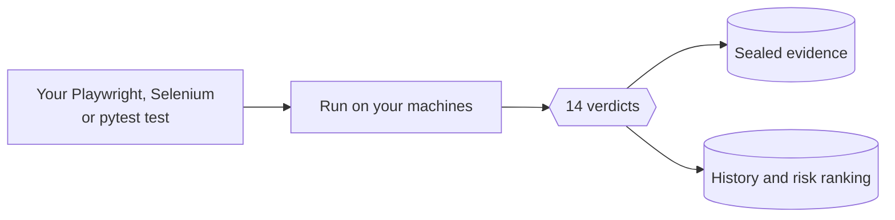

## Verdict System LLC

**Makers of [Nexus Studio](https://sentinel-nexusstudio.com): the QA studio that runs on your own machines.**

Nexus Studio is a Windows desktop app for QA teams. It records, writes and imports **Playwright, Selenium and pytest**
tests, runs them on Chromium, Firefox, WebKit and real Android phones, and gives every run **one of 14 verdicts**
instead of pass or fail. Every failure files its report, metadata, raw log, screenshot and, for real failures, its
video, sealed in a SHA-256 chain. Tests, evidence and history stay on your machines.

| | |
|---|---|
| **See the code it writes** | [nexus-studio-examples](https://github.com/verdict-system-LLC/nexus-studio-examples): one test per verdict, runnable without the Studio |
| **How verdicts are decided** | [sentinel-nexusstudio.com/docs/verdicts](https://sentinel-nexusstudio.com/docs/verdicts) |
| **Support** | 24/7, first response in under 8 hours; every release supported for 1 year ([details](https://sentinel-nexusstudio.com/trust)) |

Not related to Nexus Studios, the creative studio.
